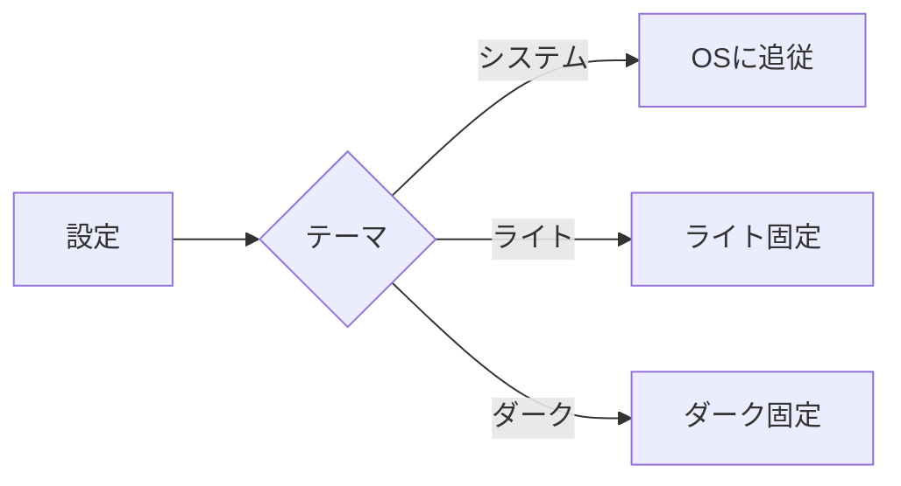
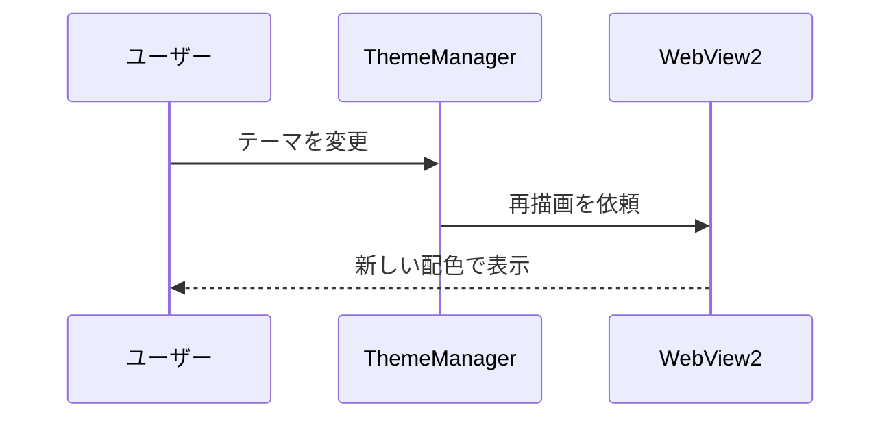

# ダークモード確認用サンプル

ライト / ダークを切り替えて、見た目が崩れていないか確認するためのファイルです。

## 本文と書式

通常の段落です。**太字**、*斜体*、~~取り消し線~~、`インラインコード`、[リンク](https://github.com/BouKiCHi/MarkdownViewer) を含みます。

> 引用ブロックです。背景と文字色のコントラストを確認します。

- 箇条書き 1
- 箇条書き 2
  - 入れ子の項目

1. 番号付き 1
2. 番号付き 2

- [x] タスク（完了）
- [ ] タスク（未完了）

---

## 表

| 項目 | ライト | ダーク |
| --- | --- | --- |
| 背景 | `#ffffff` | `#0d1117` |
| 本文 | `#1f2328` | `#f0f6fc` |
| コード | GitHub 風 | okaidia |

## コードブロック

```csharp
public static class Hello {
  // コメント
  public static string Greet(string name) => $"Hello, {name}!";
}
```

```json
{
  "Theme": "System",
  "IsHistoryPaneVisible": true,
  "Count": 3
}
```

```typescript
type Theme = "System" | "Light" | "Dark";
const apply = (theme: Theme): void => console.log(theme);
```

## Mermaid





## 生 HTML

<details>
<summary>details（クリックで開く）</summary>

中身のテキストです。

</details>

<kbd>Ctrl</kbd> + <kbd>R</kbd> で再読み込みできます。
